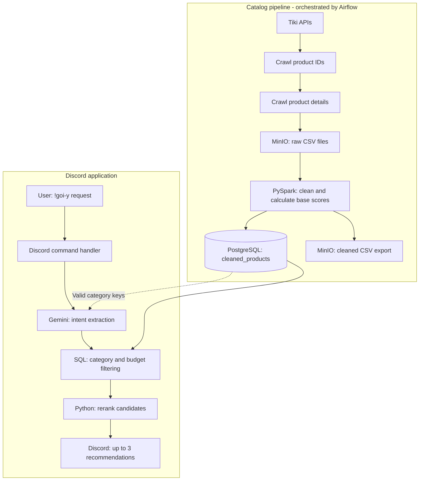

# Tiki Product Recommendation Bot

A Python Discord bot that turns Vietnamese shopping requests into product recommendations from a stored Tiki catalog. Gemini extracts the user's intent, PostgreSQL retrieves candidate products, and a rule-based scoring module selects up to three recommendations.

The project combines application development, external API integration, relational data access, and an Airflow-managed catalog pipeline.

## Features

- Accept shopping requests in Vietnamese through the `!goi-y` Discord command.
- Extract a product category, maximum budget in VND, and feature keywords with the Gemini API.
- Filter products with parameterized PostgreSQL queries and rerank up to 50 candidates.
- Return Discord embeds containing product prices, discounts, scores, and Tiki links.
- Collect and prepare the product catalog through a daily Airflow pipeline, with CSV storage in MinIO and ID-based PostgreSQL upserts.

## Example

```text
!goi-y tìm tai nghe bluetooth chống ồn dưới 500 nghìn
!goi-y gợi ý pin sạc dự phòng dưới 1 triệu
!goi-y tìm đồng hồ thông minh
```

An illustrative intent extracted from the first request:

```json
{
  "category_key": "tai-nghe-bluetooth",
  "max_price": 500000,
  "keywords": ["chống ồn"]
}
```

The bot displays the interpreted request and returns up to three matching products. Results depend on the categories and products currently stored in the database.

## Architecture



The catalog is updated in batch. Recommendation requests query the stored catalog; they do not start a new crawl.

### Application modules

| Module | Responsibility |
| --- | --- |
| [bot/main.py](bot/main.py) | Discord events, command handling, and result embeds |
| [bot/nlp_engine.py](bot/nlp_engine.py) | Gemini configuration, prompt construction, and JSON parsing |
| [bot/database.py](bot/database.py) | PostgreSQL connections, category loading, and candidate retrieval |
| [bot/recommender.py](bot/recommender.py) | Dynamic scoring and selection of the top results |

### Gemini integration

1. When the bot connects, it loads distinct category keys from PostgreSQL.
2. The prompt includes the shopping request and the available categories.
3. Gemini is asked to return `category_key`, `max_price`, and `keywords` as JSON. A missing budget is represented by `null`.
4. The application removes Markdown code fences if present and parses the response with `json.loads()`.
5. The parsed fields are passed to the database and ranking modules.

The configured model is `gemini-3.5-flash`, set directly in [bot/nlp_engine.py](bot/nlp_engine.py). There is currently no model-name environment variable.

Gemini handles intent extraction. Product retrieval and ranking are implemented in SQL and Python.

### Recommendation scoring

The pipeline calculates a popularity-oriented base score:

```text
base_score = quantity_sold_value * 0.5
           + review_count * 0.3
           + discount_rate * 0.2
```

For each request, the database selects up to 50 products matching the category and, when supplied, the maximum price, ordered by `base_score`.

The ranking module adds the following dynamic bonuses:

| Condition | Bonus |
| --- | ---: |
| Each keyword found as a case-insensitive substring in the product name | +500 |
| Positive product price between 70% and 100% of the supplied budget | +300 |
| Positive product price below 70% of the supplied budget | +150 |
| Discount rate of at least 20% | +200 |

The two budget bonuses are mutually exclusive and apply only when a budget is supplied.

```text
total_score = base_score + 2 * dynamic_score
```

The candidates are sorted by total score and up to three are returned. These weights are heuristic; the repository does not include a benchmark establishing their recommendation quality.

## Repository structure

```text
.
├── bot/
│   ├── main.py
│   ├── nlp_engine.py
│   ├── database.py
│   └── recommender.py
├── dags/
│   └── tiki_pipeline_dag.py
├── scripts/
│   ├── crawl_id_local.py
│   ├── crawl_product_data_local.py
│   ├── clean_data_pyspark.py
│   ├── crawl_danhmuc.py
│   ├── crawl_comments.py
